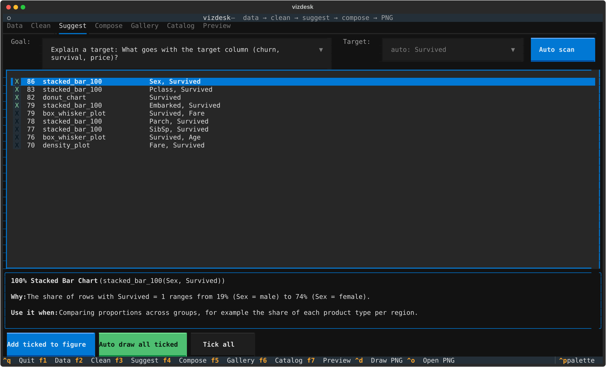
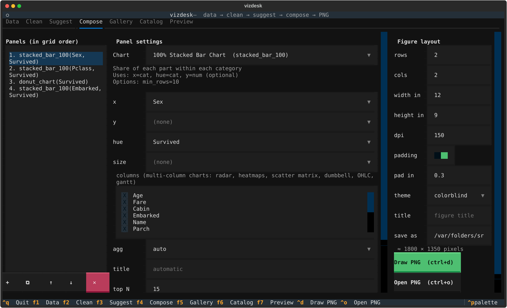
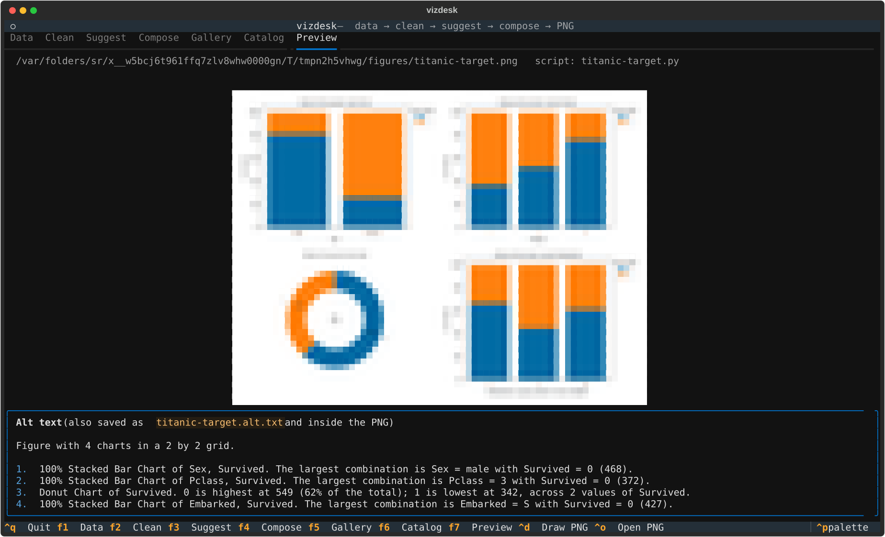
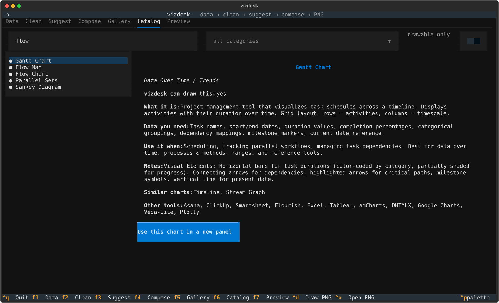
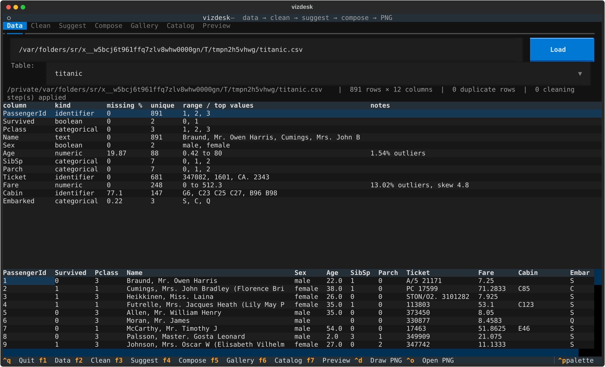
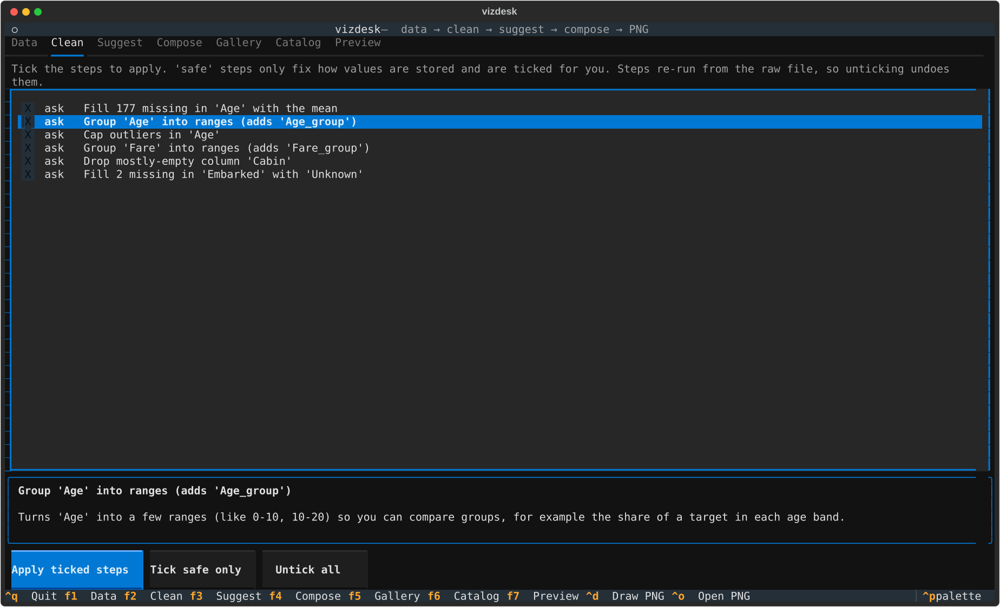
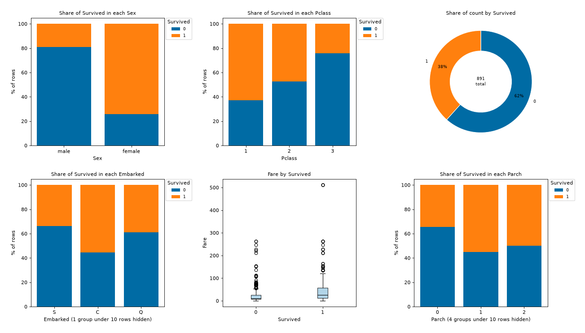
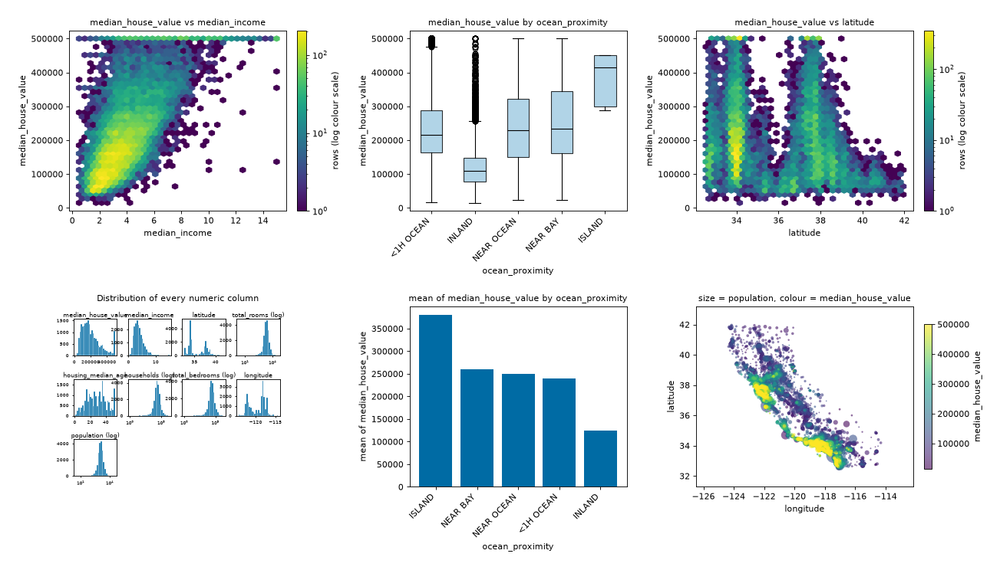
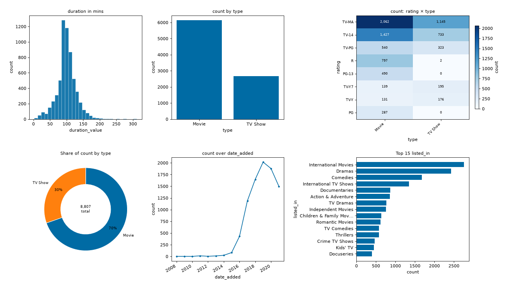

<div align="center">

<picture>
  <source media="(prefers-color-scheme: dark)" srcset="https://raw.githubusercontent.com/rafsunsheikh/vizdesk/main/docs/images/logo-dark.svg">
  
</picture>

**From spreadsheet to clear charts, right in your terminal.**

[](https://pypi.org/project/vizdesk/)
[](https://www.npmjs.com/package/vizdesk)
[](https://pypi.org/project/vizdesk/)
[](https://github.com/rafsunsheikh/vizdesk/blob/main/LICENSE)


<sub>Loading Titanic data, accepting the cleaning steps, asking "what goes with survival?", and drawing the answer.</sub>

[Install](#install) · [Quick start](#quick-start) · [Tour](#a-quick-tour) · [Command line](#command-line) · [How it decides](#how-it-decides)

</div>

vizdesk reads your CSV or Excel files, tells you what needs cleaning, and suggests the charts a data scientist would draw first, each with the reason and the numbers behind it. You pick, tweak the layout, and get PNGs, plus the Python code to rebuild them in a notebook.

There is **no LLM** inside. Every suggestion comes from fixed rules and statistics on your data, so it runs offline, gives the same answer every time, and never sends your data anywhere.

## Features

- 🔎 **Understands your columns**: numbers, categories, dates, years, IDs, comma-separated lists, `90 min` style values, gaps, outliers, caps.
- 🧹 **Suggests cleaning** with a plain reason for each step. Safe fixes run on their own; the rest wait for you, and can be undone.
- 🎯 **Finds the target** (churn, survived, price ...) and shows what goes with it, the way top Kaggle notebooks do.
- 📊 **66 chart types**, from histograms to sankey, chord, sunburst, calendar and candlestick, each explained in a built-in catalog [1].
- 🧩 **Your layout**: rows × columns, figure size, DPI, padding on or off, colorblind-safe colours by default.
- 🔁 **Redraw anything**: every PNG keeps a recipe, so you can change charts, columns or layout later.
- 📓 **Notebook-ready**: every figure comes with a Python script whose cleaning steps are plain pandas.
- ♿ **Alt text** for every figure, written from the data and stored inside the PNG.
- 🖼️ **Preview in the terminal** with Kitty, Ghostty, iTerm2, WezTerm or sixel graphics, or coloured blocks anywhere.

## Install

**Linux and macOS, one line**

```bash
curl -sSL https://raw.githubusercontent.com/rafsunsheikh/vizdesk/main/packaging/install/install.sh | sh
```

It puts vizdesk in its own environment and the `vizdesk` command on your PATH.
Nothing else on your machine is changed. It uses `uv` or `pipx` if you have
them, offers to fetch `uv` if you do not, and falls back to a private virtual
environment. Read it first if you prefer: the script is in this repository at
`packaging/install/install.sh`.

**If you already have uv or pipx**

```bash
uv tool install vizdesk        # or: pipx install vizdesk
```

Try it without installing: `uvx vizdesk data.csv`

**pip**

```bash
pip install vizdesk            # inside a virtual environment or a project
```

The routes above use `uv` or `pipx` because vizdesk is a command, not a library:
they give it its own environment and put `vizdesk` on your PATH. Use `pip` when
you want vizdesk inside a project or a notebook environment you already have. A
bare `pip install` into the system Python is refused on most machines now, with
`externally-managed-environment`.

**npm and Homebrew**

```bash
npm install -g vizdesk                 # runs the Python package through uv, pipx or a private environment
brew install rafsunsheikh/tap/vizdesk  # or: brew tap rafsunsheikh/tap, then brew install vizdesk
```

All of these install the same app. Python 3.10 or newer is needed; the installer
script, npm and Homebrew set it up for you.

## Quick start

```bash
vizdesk                          # open the app, then load a file from the Data tab
vizdesk sales.xlsx               # open the app with a file loaded (every sheet becomes a table)
vizdesk auto data/ --goal target # no app: draw the top suggestions for every CSV/Excel file in data/
```

Your files are never changed. Figures go to `./vizdesk-output` unless you pass `-o`.

## A quick tour

<table>
  <tr>
    <td width="50%"></td>
    <td width="50%"></td>
  </tr>
  <tr>
    <td><b>Suggest.</b> Pick a goal and a target; each chart comes with its reason, like <i>"the share of rows with Survived = 1 ranges from 19% (male) to 74% (female)"</i>.</td>
    <td><b>Compose.</b> Change any panel's chart, columns, aggregation or options, and set the grid, size, DPI and padding.</td>
  </tr>
  <tr>
    <td></td>
    <td></td>
  </tr>
  <tr>
    <td><b>Preview.</b> See the figure in the terminal with its alt text, then open it full size.</td>
    <td><b>Catalog.</b> Search all 66 techniques: what each shows, the data it needs, when to use it and its limits.</td>
  </tr>
</table>

**The Data and Clean tabs**




### Keys

| Key | Action | Key | Action |
|---|---|---|---|
| `F1` | Data: load files, see the profile | `F5` | Gallery: reopen any saved figure |
| `F2` | Clean: tick cleaning steps | `F6` | Catalog: browse chart types |
| `F3` | Suggest: goal, target, suggestions | `F7` | Preview the last figure |
| `F4` | Compose: panels and layout | `ctrl+d` | Draw the PNG |
| `ctrl+o` | Open the PNG in your image viewer | `ctrl+q` | Quit |

## What you get



<sub>`vizdesk auto titanic.csv --goal target`: the six charts it picked, unedited.</sub>

**Two more examples: California housing and Netflix titles**




Each figure is saved as four files:

| File | For |
|---|---|
| `figure.png` | the image, with its alt text stored inside |
| `figure.vizdesk.json` | the recipe: source, cleaning, layout and panels, used to redraw |
| `figure.py` | a script that recreates the figure; paste its `# %%` cells into a notebook |
| `figure.alt.txt` | alt text for reports and screen readers, e.g. *"Laptop is highest at 652,645 (40% of the total)"* |

## Command line

Everything the app does also works from the command line, for scripts and pipelines.

```bash
vizdesk scan churn.csv --goal target                # print the profile, cleaning steps and suggestions
vizdesk auto sales.csv --count 12 --rows 2 --cols 3 --dpi 300 --no-padding --show
vizdesk draw sales.csv \
  --panel chart=bar_chart,x=region,y=revenue \
  --panel chart=sunburst_diagram,columns=Category+Sub-Category,y=Sales \
  --rows 1 --cols 2 -o out/sales.png               # pick every chart yourself
vizdesk redraw out/sales.png --set 1:chart=violin_plot --cols 3
vizdesk catalog part whole                          # search the chart catalog
vizdesk show out/sales.png                          # preview a PNG in the terminal
```

### Panel fields and options

Fields: `chart`, `x`, `y`, `hue` (colour), `size`, `columns=a+b+c`, `agg` (`auto`, `count`, `sum`, `mean`, `median`, `min`, `max`), `title`, `top_n`, `bins`, `log_y`. `agg=auto` sums columns that look like totals (sales, revenue, units ...) and averages the rest.

Any other `key=value` is an option:

| Option | Example | Effect |
|---|---|---|
| `filter` | `filter=Name=AAPL`, `filter=region=North\|South` | keep only matching rows |
| `split` | `split=listed_in` | count each item of a comma-separated column |
| `order` | `order=label` | natural order (1, 2, 3; age bands) instead of biggest first |
| `log` | `log=x`, `log=y`, `log=xy` | log scale; zeros use a symmetric log |
| `min_rows` | `min_rows=30` | hide groups smaller than this in 100% bars (default 10) |

Some charts read their own, such as `rolling=50` (line), `reversal=4%` (kagi), `last=120` (candlestick) and `geojson=regions.geojson; key=name` (maps). The Compose tab lists them for the selected chart.

## How it decides

You pick a goal; vizdesk picks the charts that answer it for your columns.

| Goal | What it reaches for |
|---|---|
| **explore** | a balanced overview: the best one or two charts of each goal below |
| **target** | the target split, its share in every category, numeric columns split by it |
| **distribution** | a histogram of every numeric column, log scales for long tails, box, violin, density |
| **comparison** | totals and averages by group, grouped bars, error bars, top 15 of many-valued columns |
| **relationship** | the strongest pairs (skipping near-duplicates), correlation heatmap, bubble, scatter matrix |
| **composition** | hierarchies such as Category > Sub-Category as sunburst or treemap; shares of totals only |
| **trend** | lines over dates or years, year × month heatmap; candlestick and moving average for prices |
| **ranking** | top 15 by a total or by count, never by an average of tiny groups |
| **data quality** | missing values, outliers, capped values |

The rules were tuned on seven popular Kaggle datasets (Telco churn, Titanic, California housing, Netflix, Superstore, S&P 500, Wine reviews) and checked against the charts drawn in their top-voted notebooks [2]. Each fix is kept as a test.

## The chart catalog

All 66 techniques, and vizdesk can draw every one of them. Search from the
Catalog tab (`F6`) or with `vizdesk catalog <words>`.

### Distributions, 8

| Chart | What it shows |
|---|---|
| Histogram | How often values fall in each range. The usual first look at one number column. |
| Histogram Grid | One small histogram per numeric column, so you can compare shapes at a glance. |
| Density Plot | A smooth version of a histogram, with no bins to choose. |
| Box & Whisker Plot | The middle half of the data, the median, and the outliers. |
| Violin Plot | A box plot with the full shape of the distribution drawn around it. |
| ECDF Plot | For every value, the share of rows at or below it. Nothing is hidden or binned. |
| Q-Q Plot | Whether your data follows a normal curve. Points on the diagonal mean yes. |
| Stem & Leaf Plot | A small table that keeps every value while still showing the shape. |

### Comparisons, 12

| Chart | What it shows |
|---|---|
| Bar Chart | How much of something in each category. The workhorse. |
| Multi-set Bar Chart | Several series side by side under each category. |
| Dot Plot (Cleveland) | One dot per category. Less ink than bars and no zero baseline needed. |
| Lollipop Chart | A bar replaced by a line and a dot. Easier to read when bars are similar lengths. |
| Dumbbell Chart | Two dots joined by a line: the gap between before and after. |
| Bullet Graph | One number against its target and a good or bad band. Built for dashboards. |
| Radar Chart | Several measures for one thing, on spokes from a centre. |
| Radial Bar Chart | A bar chart bent into rings. |
| Radial Column Chart | Bars growing outward from a centre, grouped by spoke. |
| Marimekko Chart | Two categories at once: bar width is one, bar height the other. |
| Pictogram Chart | Repeated icons instead of bars, one icon per unit. |
| Tally Chart | Counts as tally marks, the way you would record them by hand. |

### Relationships, 8

| Chart | What it shows |
|---|---|
| Scatterplot | Whether two numbers move together. |
| Bubble Chart | A scatterplot with a third number as the size of each dot. |
| Hexbin Plot | A scatterplot for very many points: hexagons coloured by how many land in each. |
| Scatter Matrix | A scatterplot for every pair of numeric columns, in one grid. |
| Correlation Heatmap | How strongly every pair of numbers moves together, from -1 to +1. |
| Heatmap (Cross-tab) | A grid coloured by the count for each pair of categories. |
| Parallel Coordinates Plot | One line per row across several axes, to spot groups and patterns. |
| Span Chart | The range between a low and a high value, rather than single points. |

### Part to whole, 5

| Chart | What it shows |
|---|---|
| Pie Chart | Shares of a total, as slices. Best with a handful of categories. |
| Donut Chart | A pie with the middle removed, which makes arcs easier to compare. |
| Stacked Bar Graph | Totals per bar, split into their parts. |
| 100% Stacked Bar Chart | Shares per bar, every bar the same height. Compares mix, not size. |
| Treemap | Nested rectangles sized by value. Good for hierarchies with many items. |

### Over time, 8

| Chart | What it shows |
|---|---|
| Line Graph | How a number changes over time. |
| Area Graph | A line with the space beneath it filled, to stress the total. |
| Stacked Area Graph | Several series stacked, so you see both the parts and the whole. |
| Stream Graph | Stacked areas around a centre line, for how a mix shifts over time. |
| Calendar | Values laid out on monthly grids, to find days and weekday patterns. |
| Timeline | Events in order along a line. |
| Gantt Chart | Tasks as bars across a schedule, showing overlap and duration. |
| Spiral Plot | Long time series wound into a spiral, to expose repeating cycles. |

### Maps, 5

| Chart | What it shows |
|---|---|
| Choropleth Map | Regions shaded by a value. Needs a GeoJSON file of the boundaries. |
| Bubble Map | Circles on a map sized by value. |
| Dot Map | One marker per occurrence, for where things are concentrated. |
| Connection Map | Lines joining places, for links and routes. |
| Flow Map | Lines whose thickness shows how much moves between places. |

### Networks and hierarchies, 6

| Chart | What it shows |
|---|---|
| Network Diagram | Things as dots and their connections as lines. |
| Arc Diagram | Connections as arcs above a single row of nodes. |
| Chord Diagram | Flows between groups arranged in a circle, as ribbons. |
| Tree Diagram | A branching structure from one root. |
| Sunburst Diagram | A hierarchy as rings, the centre being the top level. |
| Circle Packing | A hierarchy as circles inside circles, sized by value. |

### Flows and processes, 3

| Chart | What it shows |
|---|---|
| Sankey Diagram | Where quantities go, with thickness showing how much. |
| Parallel Sets | How rows divide across several categorical columns. |
| Flow Chart | Steps and decisions in a process. |

### Text, 2

| Chart | What it shows |
|---|---|
| Word Frequency Bar | The most common words in a text column, filler words removed. |
| Word Cloud | The same counts as sized text. |

### Financial, 4

| Chart | What it shows |
|---|---|
| Candlestick Chart | Open, high, low and close for each period, in one symbol. |
| Open-High-Low-Close Chart | The same four prices drawn as ticks rather than bodies. |
| Kagi Chart | Price direction only, ignoring time, to filter out small moves. |
| Point & Figure Chart | Columns of Xs and Os for rises and falls, also ignoring time. |

### Reference and conceptual, 4

| Chart | What it shows |
|---|---|
| Error Bars | How uncertain each value is, drawn onto another chart. |
| Timetable | Scheduled events in a table you can scan quickly. |
| Brainstorm | Ideas and the links between them. |
| Illustration Diagram | A labelled picture, for explaining rather than measuring. |

### Data quality, 1

| Chart | What it shows |
|---|---|
| Missing Values Map | Which cells are empty, and whether the gaps cluster. |

## Alternatives

vizdesk is for getting from a raw table to finished figures. If you mainly want to look at or edit the table itself, or want a report page, these are excellent:

- [VisiData](https://github.com/saulpw/visidata): a terminal spreadsheet multitool for exploring and reshaping data.
- [Tabiew](https://github.com/shshemi/tabiew) and [csvlens](https://github.com/YS-L/csvlens): fast viewers for CSV, TSV and Parquet files.
- [ydata-profiling](https://github.com/ydataai/ydata-profiling): a full EDA report as an HTML page, in a notebook or browser.

## Development

```bash
git clone https://github.com/rafsunsheikh/vizdesk && cd vizdesk
uv venv && uv pip install -e '.[dev]'
pytest
```

The chart catalog is generated from the Data Scientists Handbook with `scripts/build_catalog.py`; the README images come from `scripts/make_readme_images.py`. Releases go to PyPI, npm and Homebrew as described in [PACKAGING.md](https://github.com/rafsunsheikh/vizdesk/blob/main/PACKAGING.md). Issues and pull requests are welcome.

## License

MIT. Built with [Textual](https://textual.textualize.io) and [matplotlib](https://matplotlib.org) [3].

## References

1. The chart catalog is based on S. Ribecca, *The Data Visualisation Catalogue*, https://datavizcatalogue.com
2. Kaggle datasets. The example images use the public-domain (CC0) [Titanic](https://www.kaggle.com/datasets/yasserh/titanic-dataset), [California housing](https://www.kaggle.com/datasets/camnugent/california-housing-prices) and [Netflix](https://www.kaggle.com/datasets/shivamb/netflix-shows) datasets.
3. Textual, https://textual.textualize.io; matplotlib, https://matplotlib.org
